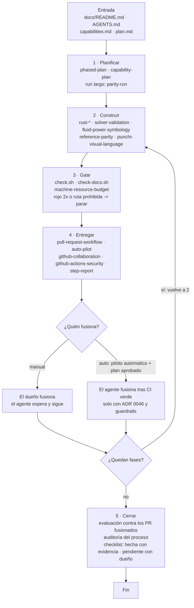

# Skill catalog

Skills for this repository live in `.agents/skills/<name>/SKILL.md` and supplement
[AGENTS.md](../../AGENTS.md). They are written in English, keep `license:
GPL-3.0-or-later` in their frontmatter and are registered here.

A skill is a procedure, not a second copy of the rules: the canonical contract stays in
`AGENTS.md` and `docs/`. If a skill and a document disagree, the document wins and the
skill is the bug.

## Active skills

| Skill | Purpose | Use when |
|---|---|---|
| [rust-idioms](rust-idioms/SKILL.md) | ownership, typed errors, units, lints and MSRV | writing, reviewing or debugging Rust; designing an API; fixing clippy |
| [rust-workspace-architecture](rust-workspace-architecture/SKILL.md) | acyclic crates and the three extension points | adding a crate, module or dependency edge; moving code; writing an ADR |
| [rust-testing-and-verification](rust-testing-and-verification/SKILL.md) | claim → test level, invariants, references, determinism | adding behaviour; fixing a failing test; deciding what evidence a PR needs |
| [rust-performance-and-memory](rust-performance-and-memory/SKILL.md) | budgets, allocation-free hot paths, bounded caches | solver step, draw loop, cache, profiling, budget changes |
| [untrusted-input-bounds](untrusted-input-bounds/SKILL.md) | a limit, a message and a one-past-it test for every untrusted input and every collection that grows | writing a parser, a list, a queue, a cache, an undo history or a loop over file data |
| [security-review](security-review/SKILL.md) | the surface a change touches, the control that already exists, the hostile case and the record | a change reads or writes a file, resolves a path, exports, pastes, autosaves, opens a link, or touches dependencies, workflows or a release |
| [rust-dependencies-and-supply-chain](rust-dependencies-and-supply-chain/SKILL.md) | licence allowlist, MSRV, `cargo deny`, lockfile | a crate is proposed; dependabot PR; `Cargo.toml` changes |
| [github-collaboration](github-collaboration/SKILL.md) | commits, PRs, review, issues, releases, repo settings | committing, reviewing, triaging, releasing, changelog |
| [pull-request-workflow](pull-request-workflow/SKILL.md) | one branch from updated `main` per change, gate, pull request, hand-over to the owner or the approved automatic pilot | starting any change; creating or switching a branch; committing, pushing, opening or updating a PR |
| [session-start](session-start/SKILL.md) | the read-only start of a session: load the project, report the context and wait for the owner's theme, without asking what to fix | the first message asks to read the project and get in context |
| [step-report](step-report/SKILL.md) | the end-of-step checklist: what is OK, what is missing and who unblocks it, the one next step, and the plan board when the step is a phase | handing a branch, pull request or phase back to the owner; the owner asks for a status |
| [phased-plan](phased-plan/SKILL.md) | a requested plan as Phase 0 (baseline, scope, specification), delivery phases with a phase board and a checklist per pull request, and a final evaluation and process audit | the owner asks for a plan; a run spans several pull requests; a phase closes |
| [github-actions-security](github-actions-security/SKILL.md) | workflow threat model and hardening | writing or reviewing `.github/workflows`; permissions, secrets, caches |
| [fluid-power-symbology](fluid-power-symbology/SKILL.md) | ISO 1219 conformance for pneumatic and hydraulic symbols | drawing or changing a symbol; running lint; conformance review |
| [solver-validation](solver-validation/SKILL.md) | units, invariants, ISO 6358, reference curves | implementing or tuning physics; writing a solver test |
| [machine-resource-budget](machine-resource-budget/SKILL.md) | the cargo job profile, the per-binary memory ceiling, runaway-allocation diagnosis | a build or test kills the session; the desktop slows down; a loop may allocate without a bound; an idle window keeps redrawing |
| [repo-maintenance](repo-maintenance/SKILL.md) | the maintenance pass: local backup first, merged branches and worktrees, `target` and cargo caches, CI caches, and a restore test | after a merge; weekly; when disk, caches or the local backup need review |
| [project-backup](project-backup/SKILL.md) | a compressed, verified snapshot before a risky change: what to include, the name and format, the README beside it, and the restore | before a test modification, a refactor, a destructive cleanup or a milestone |
| [punchi-visual-language](punchi-visual-language/SKILL.md) | route a visual change in the Rust window to its canonical document, its code and its evidence; controls, tokens, icons, ribbon, layout and language | changing a control, token, icon, ribbon, layout or string; reviewing the window's visual language |
| [capability-plan](capability-plan/SKILL.md) | turn a teaching need into a specified, proven capability, then improve it | starting a phase; planning a feature; deciding what the product must do next |
| [parity-run](parity-run/SKILL.md) | the loop of an owner-authorized long run: queue, one commit per capability, gate, one pull request | a parity run is authorized or resumed; a fresh session continues it after a reset |
| [auto-pilot](auto-pilot/SKILL.md) | run an approved phased plan unattended: one phase at a time, gate, PR, CI, squash merge under ADR 0046, main check and cleanup | the owner says `piloto automatico` and a phased plan is approved |
| [reference-parity](reference-parity/SKILL.md) | inspect the running parent app as the reference for symbols, animations and workflow, then prove parity without copying | a symbol, animation or workflow must match the parent app; the owner says the result does not look like the reference |
| [parent-source-review](parent-source-review/SKILL.md) | read the parent app's installed code and data read-only to derive behaviour, then reimplement it in Rust without copying bytes or files | the running app does not answer how a rule works; a timing, port order, threshold or binding must be matched |

## The order to read them

1. [rust-workspace-architecture](rust-workspace-architecture/SKILL.md) — where the code
   belongs.
2. [rust-idioms](rust-idioms/SKILL.md) — how it is written.
3. [rust-testing-and-verification](rust-testing-and-verification/SKILL.md) — how it is
   proven.
4. [rust-performance-and-memory](rust-performance-and-memory/SKILL.md) — what it costs.
5. [untrusted-input-bounds](untrusted-input-bounds/SKILL.md) — what it accepts.
6. [security-review](security-review/SKILL.md) — what it must refuse.
7. [rust-dependencies-and-supply-chain](rust-dependencies-and-supply-chain/SKILL.md) —
   what it brings in.
8. [machine-resource-budget](machine-resource-budget/SKILL.md) — what the machine can
   survive, and how to find the process when it cannot.

At the start of a session, when the owner asks to read the project and get in context,
read [session-start](session-start/SKILL.md): it is read-only, it ends with the context and
the owner's theme, and it asks no diagnostic question. Work starts when the theme is named.

Before the first edit of any change, read
[pull-request-workflow](pull-request-workflow/SKILL.md): no work happens on `main`, and
the branch, the gate and the pull request are one route. At the end of every step, before
the hand-off, read [step-report](step-report/SKILL.md): the owner reads OK / Falta /
Siguiente, or the plan board plus those three when the step is a phase, not a session log.

For the pass after a merge — the local backup, the branch and its worktree, the build and
the CI caches — read [repo-maintenance](repo-maintenance/SKILL.md): the backup is verified
before anything is deleted, and an old backup is an alert, not a deletion candidate.

For a one-off snapshot before a risky change — a test modification, a refactor, a destructive
cleanup — read [project-backup](project-backup/SKILL.md): `tar.zst` outside the repository,
`target/` excluded, the README beside the archive, and a restore test before trusting it.

For a plan the owner asks for — anything that spans more than one pull request — read
[phased-plan](phased-plan/SKILL.md) before the first branch: 0A proves the baseline, 0B
fixes the scope and 0C writes the acceptance and the checklists, so no phase starts as code
and every delivery arrives with its marked list.

For a change to the window — a panel, a dock, the ribbon, the view strip or a new
breakpoint — read [punchi-visual-language](punchi-visual-language/SKILL.md) and [The window
adapts](../../docs/ui-ux.md#22-the-window-adapts) before choosing a width: the content sets
the limits, the room chooses the mode.

For a capability that does something a student needs — that is most of the product — read
[capability-plan](capability-plan/SKILL.md) first: it is the gate that turns a need into a
requirement, and it names the layer each capability lands in.

For a symbol change, read [fluid-power-symbology](fluid-power-symbology/SKILL.md) before
touching the file, and [solver-validation](solver-validation/SKILL.md) if the change also
changes physics. Before opening the PR, read
[github-collaboration](github-collaboration/SKILL.md) for what the body must claim; for a
workflow change, also [github-actions-security](github-actions-security/SKILL.md).

## The flow at a glance

The catalog is a set of procedures; this is how they chain. Each card names the skills
that apply at that stage, not all of them: the table above has the full list.

The route is the one in [pull-request-workflow](pull-request-workflow/SKILL.md): a branch
from updated `main`, the gate, a pull request with its checklist, and a merge. The phases
are [phased-plan](phased-plan/SKILL.md)'s: Phase 0 proves the ground and writes the
evidence, each delivery phase is one merged pull request, and the final phase evaluates and
audits. The diamond is the merge policy: **manual** by default; **automatic** only when the
owner says `piloto automatico` and an approved phased plan exists, under
[ADR 0046](../../docs/adr/0046-the-auto-pilot-runs-a-planned-batch.md)
([auto-pilot](auto-pilot/SKILL.md)); [ADR 0043](../../docs/adr/0043-the-agent-merges-under-guardrails.md)
is the historical ribbon pilot. One pull request at a time either way. In the automatic run,
auto-pilot closes the branch and continues; [repo-maintenance](repo-maintenance/SKILL.md) is
the periodic pass that closes the branch, the worktree and the caches, after the local backup
is verified.

## Where the guidance comes from

The Rust skills are distilled from the sources below, then narrowed to this repository's
rules. None of their text is vendored; only the reference is recorded.

- [Rust API Guidelines](https://rust-lang.github.io/api-guidelines/) — naming, traits,
  documentation, future-proofing.
- [Google Rust Style Guide](https://google.github.io/styleguide/rustguide.html) —
  small, readable, owned code.
- [Effective Rust](https://www.lurklurk.org/effective-rust/) — types, traits, errors.
- [Rust Design Patterns](https://rust-unofficial.github.io/patterns/) — idioms and
  anti-patterns.
- [Microsoft Pragmatic Rust Guidelines](https://microsoft.github.io/rust-guidelines/) —
  application-level pragmatism.
- [`cargo-deny` book](https://embarkstudios.github.io/cargo-deny/) and
  [RustSec](https://rustsec.org/) — licences, advisories, bans, sources.
- [Conventional Commits](https://www.conventionalcommits.org/en/v1.0.0/),
  [DCO](https://developercertificate.org/),
  [Keep a Changelog](https://keepachangelog.com/en/1.1.0/),
  [SemVer](https://semver.org/) — the collaboration rules.
- [GitHub Actions security hardening](https://docs.github.com/en/actions/security-for-github-actions/security-guides/security-hardening-for-github-actions)
  and [OpenSSF Scorecard](https://github.com/ossf/scorecard) — CI and supply chain.
- ISO 1219-1:2012, ISO 1219-2:2012, ISO 1219-3:2016 — symbology. Read the standard; do
  not reproduce it.
- [Emil Kowalski's *Animations on the Web*](https://animations.dev/), through
  [vercel-labs/open-agents `web-animation-design`](https://github.com/vercel-labs/open-agents/blob/main/.agents/skills/web-animation-design/SKILL.md)
  — when an interface should move and when it should not. Only the criteria were adapted;
  the duration and the curve are this project's theme and [Motion](../../docs/ui-ux.md#motion)
  contract, not the course's.

Adjacent public collections worth reading for a second opinion (not dependencies, and not
copied here): [morganlinton/BeautifulRust](https://github.com/morganlinton/BeautifulRust)
(Rust best practices, review and porting skills) and
[github/awesome-copilot](https://github.com/github/awesome-copilot) (GitHub workflow,
commit and release skills). When one of them disagrees with `AGENTS.md`, this repository
wins.

## Where the workflow comes from

The flow above is the common shape of professional delivery, narrowed to a solo
maintainer. None of these is a dependency, and none of their text is vendored: the
reference is recorded so a session can check the reasoning.

- [Google Engineering Practices: Small CLs](https://google.github.io/eng-practices/review/developer/small-cls.html) —
  one self-contained change, its test in the same change, stacking when a change depends
  on another, and never breaking the build.
- [DORA: trunk-based development](https://dora.dev/capabilities/trunk-based-development/) —
  small batches, branches measured in hours, three or fewer active, merged at least daily,
  and a trunk that stays green.
- [GitHub flow](https://docs.github.com/en/get-started/using-github/github-flow) and the
  [merge queue](https://docs.github.com/en/repositories/configuring-branches-and-merges-in-your-repository/configuring-pull-request-merges/managing-a-merge-queue) —
  a protected `main`, required checks, and the combined result tested before it lands.
- [Agent Skills specification](https://agentskills.io/specification) — the `SKILL.md`
  directory, the frontmatter and the progressive disclosure this catalog follows.
- [obra/superpowers](https://github.com/obra/superpowers) — the closest public methodology:
  brainstorm, worktree,
  [write the plan](https://github.com/obra/superpowers/blob/main/skills/writing-plans/SKILL.md),
  execute it task by task, and
  [verify before claiming completion](https://github.com/obra/superpowers/blob/main/skills/verification-before-completion/SKILL.md).
- [vercel-labs/open-agents](https://github.com/vercel-labs/open-agents) — the
  `.agents/skills` layout this repository shares and its
  [plan mode](https://github.com/vercel-labs/open-agents/blob/main/.agents/skills/plan-mode/SKILL.md),
  which explores, asks, designs, presents the plan and waits for approval before
  implementing.
- [Atul Gawande, *A Life-Saving Checklist*](https://www.newyorker.com/magazine/2007/12/10/the-checklist) —
  the checklist as the tool against forgetting, which is what the delivery checklist is.

The differences are deliberate. This repository has one maintainer, so it holds **one
active branch** instead of DORA's three, and the owner is the merge queue; a second branch
needs an explicit exception. Auto-merge exists only behind an ADR, while open-agents makes
auto-commit and auto-PR a preference, never always-on.

## Provenance and attribution

This catalog is a personal compilation written for this project. It is not a copy of the
sources it cites.

- **Researched sources.** A skill that distils a public source names it and its creator in
  its own "Read first" or in [Where the guidance comes from](#where-the-guidance-comes-from).
  Only the reference is kept; no text, screenshot or asset from the source is vendored.
- **Original work.** The rest is original: the procedures, the gotchas, the templates, the
  evidence rules and the checklists were written here by the project owner (PunchiSoft).
- **Reuse.** If you take a skill or a procedure outside this repository, keep the
  GPL-3.0-or-later licence, name PunchiSoft as the author of the compilation and name the
  cited source when the skill derives from one. Do not present the compilation as your own
  or as the cited creator's work.
- **No third-party assets.** No manual, symbol set, screenshot or file from another program
  is stored under `.agents/skills/`; [AGENTS.md](../../AGENTS.md) and
  [docs/symbology.md](../../docs/symbology.md) own that rule.

## Adding a skill

Create `.agents/skills/<name>/SKILL.md` in English: `name` equal to the folder in
kebab-case, a description under 300 characters with a `Use when` clause, `license:
GPL-3.0-or-later`, a procedure, gotchas and a validation section. Register it in the
table above and in [AGENTS.md](../../AGENTS.md) if it changes a rule. A skill that only
restates another document is not worth the context it costs.

## Skills still missing

- `schematic-editor` — canvas interaction contracts: selection, snapping, undo,
  hit-testing tolerance.
- `release-and-packaging` — AppImage, Flatpak and Windows packaging, signed tags and
  reproducible artefacts (the collaboration half is in
  [github-collaboration](github-collaboration/SKILL.md)).
