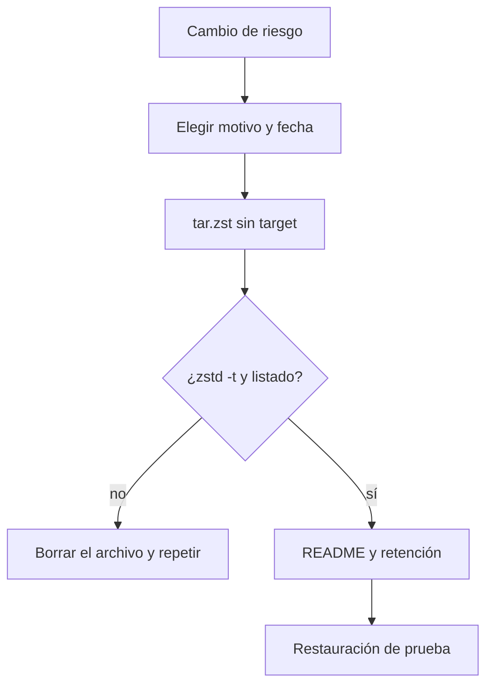

# Project backup

A backup is a separate copy. A branch, a stash or a commit lives in the same `.git` and
disappears with it; it is not a backup. This skill takes one snapshot before a risky change,
compresses it, verifies it, and leaves the README beside it.

The periodic pass is [repo-maintenance](../repo-maintenance/SKILL.md); this skill is the
one-off snapshot.

## The flow



## When it runs

- Before a test modification that may need to be undone.
- Before a refactor or a destructive cleanup.
- At a milestone or before a hand-off.
- Never instead of the off-site copy: this is a local snapshot.

## What to back up

| Include | Why |
|---|---|
| `.git/` and the working tree | the history and the exact state, committed or not |
| `Cargo.lock`, `Cargo.toml`, `rust-toolchain.toml` | a reproducible build |
| `docs-private/` | ignored by Git; a bundle would miss it |
| `spikes/` | untracked work worth keeping |
| `assets/`, `docs/`, `scripts-dev/`, `packaging/` | source and record |

| Exclude | Why |
|---|---|
| `target/` | around 8 GB; it is rebuilt |
| `.worktrees/` | copies of the same repository; back up a dirty worktree separately |
| `dist/`, `*.AppImage`, `*.flatpak` | build output |
| `~/.cargo`, `~/.cache`, CI caches | not the project |

## Format and name

```text
[fecha]-backup [Version]-[motivo].formato
```

- **Date:** `YYYY-MM-DD`, local.
- **Version:** `workspace.package.version` from `Cargo.toml` (`0.1.0` today).
- **Motive:** `antes-de-pruebas`, `pre-refactor`, `hito`, `entrega`; no spaces.
- **Format:** `tar` + `zstd` (`.tar.zst`); `.tar.gz` when zstd is missing.
- **Example:** `2026-11-23-backup 0.1.0-antes-de-pruebas.tar.zst`.
- The space between `backup` and the version is literal: quote the name everywhere.
- A second backup with the same motive the same day adds a suffix:
  `2026-11-23-backup 0.1.0-antes-de-pruebas-2.tar.zst`.

The folder carries one README that describes the format, the contents, the exclusions, the
restore and the retention; not one README per archive.

## Procedure

0. **Read the state.** `df -h /`, `du -sh target`, `git status --short`; stop editing while
   the archive is written.
1. **Choose the folder.** `/home/cristian/Desarrollo/backups/punchi-fluid-lab`, outside the
   repository. `mkdir -p` it.
2. **Build the name and the archive.**
   ```bash
   SRC="/home/cristian/Desarrollo/punchi-fluid-lab (Rust)"
   DEST="/home/cristian/Desarrollo/backups/punchi-fluid-lab"
   VERSION="$(sed -n '/^\[workspace.package\]/,/^\[/s/^version = "\(.*\)"$/\1/p' "$SRC/Cargo.toml" | head -1)"
   NAME="$(date +%F)-backup ${VERSION}-antes-de-pruebas.tar.zst"

   tar --zstd -cf "$DEST/$NAME" \
     --exclude='target' --exclude='.worktrees' --exclude='dist' \
     --exclude='*.AppImage' --exclude='*.flatpak' \
     -C "$(dirname "$SRC")" "$(basename "$SRC")"
   ```
   `-C` plus `basename` handles the spaces and parentheses in the project name.
3. **Verify.** `zstd -t "$DEST/$NAME"`, `tar -tf "$DEST/$NAME" | head`, `du -h
   "$DEST/$NAME"`. The listing must contain `.git/` and `Cargo.lock`, and the file must not
   be empty.
4. **Restore test.** Extract into `/tmp`, then `git status --short` and `git fsck --full`.
   A backup that was never restored is a hypothesis.
5. **Keep the README current.** The folder README states the format, the contents, the
   exclusions, the restore and the retention; update it in the same pass when any of those
   changes.
6. **Retain.** 7 daily, 4 weekly, 12 monthly; delete the oldest only after the new archive
   verifies. An old backup is an alert, not a deletion candidate.
7. **Report.** [step-report](../step-report/SKILL.md) with the path, the size, the
   verification and the restore result.

## The README beside the backups

It is the local contract for the folder, not a copy of this skill:

- the name pattern and the format;
- what the archive includes and excludes;
- the create, verify and restore commands;
- the size expectation with `target/` excluded;
- the retention and the warning that the same disk is not disaster recovery.

## Gotchas

- **The path has spaces and parentheses.** Quote it and use `-C` plus `basename`.
- **The archive name contains a space.** `tar -cf "$DEST/$NAME"` and `zstd -t "$ARCHIVE"`
  are quoted or the shell splits the name.
- **`.git` is already compressed.** zstd does not shrink the pack much; the real saving is
  excluding `target/`.
- **`.worktrees` is excluded.** A dirty worktree is not in the archive; commit it or copy it
  separately.
- **`tar` does not honor `.gitignore`.** `docs-private/` is included, which is intended;
  check the listing.
- **A backup inside the repository can be committed or removed by `git clean -fdx`.** Keep
  it outside the tree and outside `.git`.
- **The same disk is a snapshot, not disaster recovery.** Copy the archive to an external
  medium.
- **A branch, a stash or a commit is not a backup.** They share the object database.
- **Stop editing while the archive is written.** Excluding `target/` avoids most churn, but
  a source file changing mid-read is a partial copy.
- **`zstd -t` and `tar -tf` prove the file, not the restore.** Do the restore test.

## Validation

```bash
ls -lh /home/cristian/Desarrollo/backups/punchi-fluid-lab/*.tar.zst
zstd -t <archive>
tar -tf <archive> | grep -E '(^|/)\.git/|Cargo.lock|docs-private/' | head
RESTORE="$(mktemp -d)"
tar --zstd -xf <archive> -C "$RESTORE"
git -C "$RESTORE/punchi-fluid-lab (Rust)" status --short
git -C "$RESTORE/punchi-fluid-lab (Rust)" fsck --full
```

The pass is valid when the archive verifies, the listing holds the expected paths, and the
restore answers with a clean `git status` and a passing `git fsck`.

## Adapted to this repository

| Need | Where |
|---|---|
| The folder | `/home/cristian/Desarrollo/backups/punchi-fluid-lab` |
| The README | the same folder |
| The format | `tar.zst`; zstd 1.5.7 is installed |
| The version | `[workspace.package] version` in `Cargo.toml`; `0.1.0` today |
| The source | `/home/cristian/Desarrollo/punchi-fluid-lab (Rust)` |
| The periodic pass | [repo-maintenance](../repo-maintenance/SKILL.md) |
| Off-site | GitHub is the remote, not a local backup |
