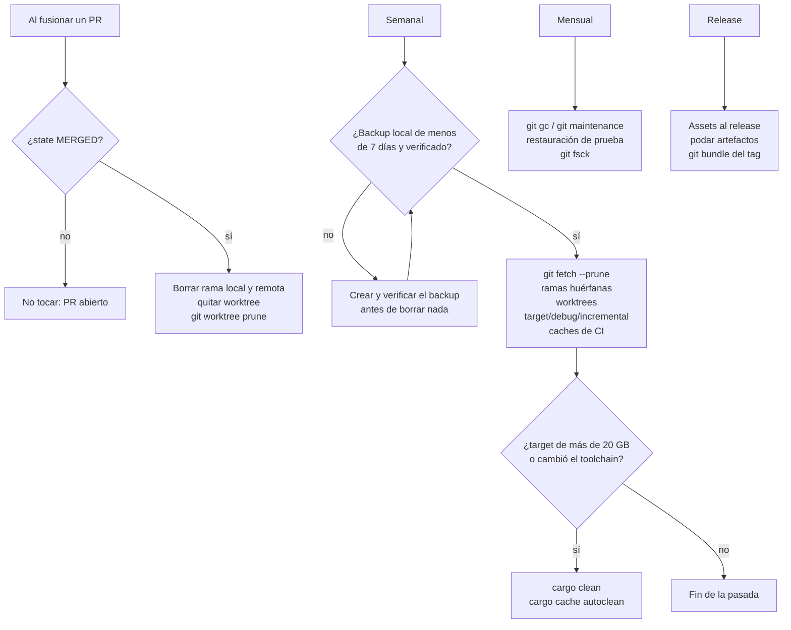

# Repository maintenance

Four kinds of bytes live in a working copy, and they are treated differently:

| Kind | Examples | Rule |
|---|---|---|
| Source | crates, apps, assets, docs, `Cargo.lock`, `docs-private` | keep; it is what a backup copies |
| Disposable | `target/`, `~/.cargo/registry`, CI caches and artifacts | delete on schedule; rebuild or re-download |
| Local backup | a bundle or mirror on another medium, a restic or borg snapshot | verify, rotate, restore-test; never delete the last copy |
| Recovery copy | `$XDG_DATA_HOME/punchi-fluid/recovery.pfluid` (usually `~/.local/share/...`) | not a backup; the app discards it on save, open or discard |

The route is [pull-request-workflow](../pull-request-workflow/SKILL.md); the build's memory
budget is [machine-resource-budget](../machine-resource-budget/SKILL.md). This skill is the
schedule and the checks.

## The flow



## What a local backup is

A local backup is a copy **on a different medium** — an external USB disk, a NAS, a second
internal disk — or at least outside the working tree. A bundle on the same disk protects
against a bad rebase or a deleted branch, not against the disk dying; it is a snapshot, not a
backup. GitHub is off-site, not local, and it replaces neither.

A complete local backup contains the repository with `.git`, the working tree, and the
untracked notes under `docs-private/`. A `git bundle --all` does **not** carry ignored or
untracked files, so the notes are copied separately or backed up in their own repository.

It excludes `target/`, `.worktrees/`, `dist/`, `*.AppImage`, `*.flatpak`, build output and
caches: a backup that copies `target/` adds gigabytes per snapshot for nothing.

`git bundle` and `git clone --mirror` need no extra tool. `rsync` is available on most
systems; `restic`, `borg` and `timeshift` are optional — check with `command -v` before
assuming one. A file-level tool needs the exclusions above in its own configuration.

## When it runs

| Trigger | Action | Threshold |
|---|---|---|
| Merge of a pull request | branch local and remote, worktree | `gh pr view` says `MERGED` |
| Weekly | local backup freshness, branches, worktrees, `target/debug/incremental`, CI caches | backup under 7 days; branch abandoned over 14 days; incremental over 7 days |
| Weekly | record the numbers | `du -sh target`, `df -h /`, cache count |
| Monthly | `git gc`, restore test, `git fsck`, registry autoclean | `target` over 20 GB or toolchain changed |
| Release | release assets, transient artifacts, `git bundle` of the tag | the release keeps the durable copy |

## Procedure

0. **Read the state.** `git status --short`, `git worktree list`, `git branch -vv`,
   `du -sh target`, `df -h /`, `gh pr view <n> --json state,mergedAt`, and the newest file
   in the backup folder with its date.
1. **Backup first.** If the newest local backup is more than seven days old, or
   `git bundle verify` fails, create and verify one before deleting anything:
   ```bash
   mkdir -p "$HOME/Backups"
   git bundle create "$HOME/Backups/punchi-$(date +%F).bundle" --all
   git bundle verify "$HOME/Backups/punchi-$(date +%F).bundle"
   rsync -a --delete --exclude target/ --exclude .worktrees/ --exclude dist/ \
     "$PWD/" /media/<disk>/punchi/
   ```
   `docs-private/` is ignored: a `git bundle --all` does **not** carry it. Copy it, or back
   up its own repository, in the same pass.
2. **Verify the merge before deleting a branch.** `gh pr view <n> --json
   state,mergedAt,mergeCommit` must say `MERGED`. A squash-merged branch has no commit in
   `main`, so `git branch -d` refuses it; compare the branch with the merge commit —
   `git diff <merge-commit> <branch> -- <paths>` — and use `git branch -D` only when that
   shows no unique content. Never delete a branch with an open pull request.
3. **Remove the worktree.** `git worktree remove <path>`; if it refuses, read
   `git -C <path> status --short` and stop if there is unique work. `--force` only after
   checking; then `git worktree prune`.
4. **Prune branches and refs.** `git fetch --prune`; `git branch -vv` marks the remote as
   gone (`: gone]`, in the locale's wording); delete the merged ones and leave the unmerged
   for the owner.
5. **Sweep the build.** Check `pgrep -a cargo` first. `cargo clean -p <crate>` for one
   crate, `cargo clean --release`, `cargo clean` for everything. `cargo sweep --time 7` if
   installed; `rm -rf target/debug/incremental` is safe when no build runs. Never clean a
   target a session is using.
6. **Sweep the registry.** `cargo cache autoclean` if installed; otherwise leave
   `~/.cargo/registry` alone. It is re-downloadable, not precious. Never delete
   `Cargo.lock`.
7. **Prune CI caches and artifacts.** `gh actions-cache list` (extension) or the API;
   delete entries older than seven days or superseded by a lockfile or toolchain change.
   Set `save-if` on `main` in [Swatinem/rust-cache](https://github.com/Swatinem/rust-cache)
   and `retention-days` on `upload-artifact`. Do not delete a cache an active run is
   restoring.
8. **Restore test, monthly.** Restore the newest backup into a temporary directory,
   `git fsck`, `git status`, and open the project or run `cargo metadata`. A backup that was
   never restored is a hypothesis.
9. **Report.** [step-report](../step-report/SKILL.md) with what was removed, the bytes
   freed, the backup's age and what was kept and why.

## Rust

- `target/` is disposable: deleting it costs a rebuild, not data. A full `target/` measured
  8.3 GB when this was written (incremental 3.2 GB, deps 3.8 GB); measure yours and treat
  the number as a measurement, not a target.
- Test binaries live in `target/debug/deps`; there is no separate test package to clean.
  Test fixtures under `/tmp/punchi-fluid-*` are ephemeral; the OS cleans them.
- `Cargo.lock` and `rust-toolchain.toml` are source, never cache.
- CI: `CARGO_INCREMENTAL=0`, `Swatinem/rust-cache` with `save-if` on `main`, and
  `retention-days` on artifacts.
- `cargo-sweep` and `cargo-cache` are optional; install one only if the volume justifies
  it, and record the version in the pull request that adds it.

## Local backups

For a one-off snapshot before a risky change, [project-backup](../project-backup/SKILL.md)
is the dedicated procedure; this section is the recurring policy.

- **3-2-1:** three copies, two media, one off-site. A bundle on the same disk is copy one.
- **Retention:** 7 daily, 4 weekly, 12 monthly. Rotate only after the new copy verifies.
- **Freshness:** the newest local backup must be under seven days old. An older one is an
  alert, not a deletion candidate.
- **Restore:** monthly, into a temporary directory, then `git fsck` and a build or
  `cargo metadata`.
- **`docs-private`:** separately; it is the owner's repository, not this one.
- **No destination yet:** an unmounted disk or partition is not a backup until it is
  mounted, formatted and a restore has been tested. Check what is installed with
  `command -v restic borg timeshift`; if none is there, `git bundle` plus `rsync` are enough
  to start.

## Gotchas

- **A backup older than a week is an alert, not a reason to delete it.** Never delete the
  last copy; rotate after a newer one verifies.
- **A bundle on the same disk is not a backup against disk failure.** It protects against a
  bad rebase or a deleted branch.
- **`git branch -d` fails after a squash merge.** Prove the merge and use `-D`.
- **`git worktree remove` refuses a dirty worktree.** Inspect it; do not force unique work.
- **`cargo clean` during a build corrupts the target.** Check `pgrep -a cargo`.
- **A backup that includes `target/` is gigabytes of noise**, and `docs-private/` is
  invisible to `git bundle`.
- **CI cache eviction:** unused entries go after seven days, and the repository has a cache
  budget; deleting an entry costs a miss, not a failure.
- **The recovery copy is not a backup.** Deleting it loses crash recovery; archiving it does
  not protect the document.
- **Do not prune caches during a release build**, and do not clean a target the gate is
  using.

## Validation

```bash
git worktree list
git branch -vv
git status --short
du -sh target ~/.cargo
df -h /
gh api repos/PunchiSoft/punchiFluidLab/actions/caches --jq '.actions_caches | length'
git bundle verify <newest bundle>
git fsck --full
```

The pass is valid when no unmerged branch was deleted, no dirty worktree was forced, the
local backup is under seven days and verified **before** the deletions, and the numbers were
recorded.

## Adapted to this repository

| Need | Use |
|---|---|
| The route | [pull-request-workflow](../pull-request-workflow/SKILL.md) |
| The build's memory and jobs | [machine-resource-budget](../machine-resource-budget/SKILL.md) |
| The hand-off | [step-report](../step-report/SKILL.md) |
| The recovery copy | `punchi-fluid-session::safety` |
| The owner's notes | `docs-private/`, backed up separately |
| CI caches | `.github/workflows/ci.yml` with `Swatinem/rust-cache` |
