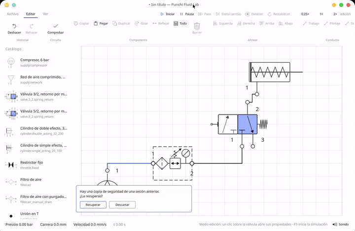

# Punchi Fluid Lab

[English](README.md) | **Español**

[](https://github.com/PunchiSoft/punchiFluidLab/actions/workflows/ci.yml)
[](LICENSE)
[](#)

> 🚧 **En construcción.** Esto es un prototipo que funciona, no un producto terminado.
> Lo construye una sola persona en los días libres que le deja su trabajo principal, así
> que avanza con constancia pero despacio, y **no hay fecha de entrega**: cuando una
> capacidad de [docs/capabilities.md](docs/capabilities.md) dice `missing` o `partial`, es
> exactamente eso, todavía no está. Si algo no existe, se dice; si está a medias, se dice
> qué parte falta.


*La ventana tal como está hoy: cinta, catálogo, hoja y barra de estado, siguiendo la paleta
del escritorio. El circuito es la hoja con la que abre el programa: un compresor alimenta la
unidad de mantenimiento, la unidad alimenta una válvula 3/2 en reposo y la válvula alimenta un
cilindro de simple efecto. Cada puerto lleva su círculo de conexión, y no hay nada en marcha,
así que los tubos conservan la tinta neutra y la barra de estado marca `0,00 bar`. La
interfaz está en español — [i18n/README.md](i18n/README.md) es el plan para los demás
idiomas.*



*La hoja en movimiento: la válvula accionada y el cilindro desplazándose, con los tubos
coloreados por la presión que llevan. 44 segundos a 4× de velocidad. [Vídeo completo]
(assets/screenshots/run.mp4), MP4, sin sonido.*

Simulador libre de circuitos neumáticos e hidráulicos, hecho para que un estudiante sin
licencia, sin presupuesto y sin conexión pueda dibujar el esquema, conectar los puertos,
ejecutar el modelo y ver moverse los actuadores. El modelo, el formato y el dibujo son Rust;
la ventana es Qt Quick.

**Estado: `0.1.0`, sin publicar.** Rebanada vertical que funciona: dibujar y editar un
circuito, conectar puerto a puerto, reunir varios circuitos en un proyecto y cambiar entre
ellos, guardarlo y abrirlo, ejecutar el modelo de gas, leer la presión en los tubos y
exportar la hoja activa a PNG o PDF.

Sin cuenta, sin clave, sin red. GPL-3.0-or-later: descárgalo, enseña con él, cámbialo,
compártelo.

**Para quién es:** estudiantes de FP e ingeniería, docentes que preparan ejercicios y talleres
que no pueden justificar una licencia comercial. La herramienta con la que se aprende no
debería ser lo que el estudiante no puede pagar.

**Lo que no es:** un visor, un curso ni un servicio en la nube. Sin telemetría, sin
suscripción, sin «edición educativa» recortada.

> **¿Retomas el proyecto?** [docs/retomar.md](docs/retomar.md) es la nota de
> continuidad: estado actual, qué se construyó paso a paso, cómo verificarlo, decisiones
> tomadas y el texto exacto para continuar en una sesión nueva.

## Por qué existe

En Latinoamérica una carrera industrial es cara antes de la primera clase. El programa con el
que un curso de mecánica o electricidad espera que aprendas cuesta como cuesta para una
empresa, y casi siempre va atado a la marca de las máquinas del laboratorio. Las licencias
de estudiante son escasas y las de docencia más, así que un curso que no puede pagarlas
termina enseñando *alrededor* de la herramienta en vez de con ella.

La consecuencia se conoce y casi nunca se dice en voz alta: el estudiante busca una copia
pirata antes que reconocer que no puede pagar. Esa copia llega con su propia factura —sin
actualizaciones, con malware en el portátil personal, con credenciales y documentos
expuestos—. La piratería es un síntoma, no un atajo, y la salida honesta es una herramienta
que no cuesta instalarla ni cuesta ejecutarla.

De ahí viene este proyecto. Lo escribe alguien que trabaja en el rubro y además enseña, y
está pensado para los dos lugares donde hace falta el mismo conocimiento: el aula sin
presupuesto y el taller que tiene que formar a su propia gente.

Ahí el valor no es decorativo. Un operario que ha visto llenarse una cámara, avanzar un
émbolo y cebarse el caudal en la relación crítica lee un cilindro lento como un diagnóstico,
no como un misterio. Un equipo que puede instalar un simulador en cada máquina puede avanzar
hacia el mantenimiento autónomo —uno de los pilares del mantenimiento productivo total— sin
comprar una licencia por puesto, que es la diferencia entre un plan y un cartel en la pared.

Esto es el motivo, no un resultado medido: el programa es un prototipo y
[docs/capabilities.md](docs/capabilities.md) dice lo que todavía falta. Pero la dirección es
lo importante. El software libre es cómo una materia deja de tener precio de entrada.

## Lo que existe hoy

| Crate | Qué hace ahora |
|---|---|
| `punchi-fluid-core` | Componentes, puertos, conexiones y unidades tipadas (bar, litro, kelvin) |
| `punchi-fluid-catalog` | Definiciones de componente leídas de archivos TOML: esquema, validación y reglas de reemplazo |
| `punchi-fluid-file` | Formato de hoja versionado (v3), escritura atómica y lista de documentos recientes |
| `punchi-fluid-solver` | Integración de masa de gas, cilindro con muelle, amortiguamiento y rozamiento, flujo ISO 6358 |
| `punchi-fluid-doc` | El documento editado: colocaciones, comandos y deshacer acotado |
| `punchi-fluid-draw` | El dibujo único del circuito, en milímetros, tras un trait `Surface` |
| `punchi-fluid-export` | Hojas normalizadas, bloque de identificación, leyenda, y los escritores PNG y PDF |
| `punchi-fluid-ffi` | El ABI C que habla la ventana: el documento, el cuadro de dibujo, los hit tests y la exportación |
| `punchi-fluid-check` | Comprobaciones de diseño: las faltas que un circuito puede tener antes de ejecutarse |
| `punchi-fluid-cli` | `validate`, `simulate` y `check` sin ventana |
| `apps/punchi-fluid-qt` | La ventana: cinta, barra lateral de catálogo, hoja, barra de estado y la paleta del escritorio, sobre el ABI C |

## Compilar y ejecutar

```bash
./scripts-dev/run.sh                                    # ventana; compila solo si hace falta
./scripts-dev/run.sh --toggle                           # arranca con la válvula accionada
./scripts-dev/run.sh --no-build --theme dark            # binario ya compilado, paleta oscura
./scripts-dev/run.sh --theme light                      # fija la paleta para una captura
cargo run --bin punchi-fluid-cli -- check circuito.pfluid   # comprobación sin ventana
```

`run.sh` compila solo cuando cambió un fuente y después ejecuta el binario directamente;
`--no-build` no invoca Cargo, y `--theme light|dark` se pasa a la ventana. Sin `--theme`,
la ventana sigue al escritorio. `--toggle` acciona la válvula; no arranca la simulación.
`check` lee el formato de hoja que guarda el editor; `validate` y `simulate` todavía leen el
formato de circuito antiguo, como explica [la referencia de la CLI](docs/reference/cli.md).

En la ventana el transporte ejecuta el modelo: **Iniciar** (F9) arranca, **Pausa** (F8)
pausa, **Paso** (F10) avanza un cuadro, **Hasta cambio** se detiene en el primer tope o
cambio de válvula, **Detener** (F5) vuelve a edición y **Restablecer** (Ctrl+R) vuelve a
`t = 0`. Una válvula con muelle se mantiene accionada mientras el puntero está pulsado o
**Espacio** se mantiene, y el selector de velocidad está junto al transporte (un cilindro de
20 mm con esta válvula completa la carrera en unos 0,13 s de tiempo simulado). La cinta
tiene tres pestañas —Archivo, Editar y Ver— y la ayuda de cada comando nombra su atajo
cuando existe. La barra lateral lista el catálogo con el símbolo propio de cada componente;
un clic lo selecciona y arrastrarlo lo coloca.

**Exportar** en Archivo abre un diálogo de guardado: un nombre `.pdf` escribe una página
vectorial, un nombre `.png` un ráster a 300 dpi. El grupo **Hoja** elige uno de los nueve
papeles con nombre —A5 a A0, Letter, Legal y Oficio— y la orientación apaisada, y marca el
que está en uso. La página lleva marco, bloque de identificación y leyenda de clases de
línea y números de puerto, y mientras alguna revisión de símbolo siga abierta lleva además
la nota de que los símbolos aún no están verificados contra ISO 1219-1. El mismo circuito
exportado dos veces produce los mismos bytes. Todavía no hay panel de márgenes, tamaño
personalizado ni resolución del PNG. La fecha es la del día de la exportación, el dibujo se
escala para encajar y la escala queda escrita en el bloque de identificación, y
`Ctrl+Shift+E` abre el diálogo.

**El papel es una decisión, no un valor por defecto.** Un plano se imprime en la hoja que usa
la oficina técnica, y no es una sola: ISO 216/5457 A5 a A0 para el mundo ISO;
Letter y Legal para el norteamericano; y **Oficio/Folio (216 × 330 mm)**, que no es ninguna de
las dos y es el papel que todavía se encuentra en la mayoría de las oficinas chilenas. El plan
está en [ADR 0012](docs/adr/0012-the-paper-a-drawing-is-printed-on.md); el tamaño
personalizado existe en la API de exportación pero no en la ventana, y la última elección
todavía no se recuerda por usuario.

Requisitos: Rust estable (fijado en `rust-toolchain.toml`), Qt 6.5 o superior con Qt Quick,
CMake y Ninja. El núcleo en Rust se compila con `cargo build --release -p punchi-fluid-ffi`;
la ventana con

```bash
cmake -S apps/punchi-fluid-qt -B apps/punchi-fluid-qt/build -G Ninja
cmake --build apps/punchi-fluid-qt/build
apps/punchi-fluid-qt/build/punchi-fluid
```

El núcleo se enlaza como biblioteca estática, así que el resultado es un solo binario sin
ruta de búsqueda. Mantenerlo en Rust es lo que además permite una compilación a
WebAssembly más adelante.

## Los componentes son archivos, no código

Cada válvula, cilindro o suministro es una definición TOML en
[assets/catalog/](assets/catalog/). La aplicación las incorpora al binario y encima
carga `~/.local/share/punchi-fluid-lab/catalog/`, donde un archivo con el mismo `id`
reemplaza al de fábrica:

```toml
id = "valve.3_2.spring_return"
category = "valve"

[behaviour]
type = "valve"
actuation = "toggle"
spring_return = true

[[behaviour.positions]]
name = "rest"
[[behaviour.positions.connection]]
from = "2"
to = "3"
conductance = 1.0e-9
```

Cada posición declara los caminos que abre, clasificados por el **rol** de los
puertos (`supply`, `working`, `exhaust`), así que una válvula 5/2 es un archivo nuevo
y no una rama nueva en el código. El símbolo es una lista de primitivas en el mismo
archivo. Un archivo con un error se omite, se explica en el panel de catálogo y el
resto sigue funcionando. La referencia completa de campos está en
[assets/catalog/README.md](assets/catalog/README.md).

## La interfaz

Tres regiones y nada más: una **cinta** para lo que afecta al documento entero, una
**barra lateral que es el catálogo** (agrupada por categoría, con cada componente
dibujado por su propio símbolo, arrastrable a la hoja) y la **hoja**, donde vive el
circuito y donde ocurre la simulación. Barra de estado abajo. Edición y simulación son
modos visiblemente distintos, para que un clic perdido durante una demostración no
destruya trabajo.

La aplicación toma colores, acento y tamaño de letra del escritorio: lee `kdeglobals`
y sigue el portal `org.freedesktop.appearance color-scheme`, así que se ve como el
resto de Plasma y sigue un cambio de esquema en vivo sin reiniciar. Una capa semántica
de tokens es el único lugar donde existe un color: un `Color32::` en cualquier otro
sitio falla una prueba. Los componentes usan su propio símbolo, nunca un set de iconos
aparte.

**Estado honesto:** las regiones, los tokens, el mapa de teclado y el panel de ayuda
están hechos. Los iconos simbólicos de Breeze todavía no se cargan (los botones usan
texto), la *familia* tipográfica del escritorio se lee pero no se carga (el tamaño sí)
y los textos de la interfaz siguen literales hasta el pase a Fluent de M6.

La especificación completa —regiones, mapa de teclado, requisitos de contraste y lo
que el diseño rechaza— está en [docs/ui-ux.md](docs/ui-ux.md). Los hitos con sus
criterios de aceptación están en [docs/plan.md](docs/plan.md).

## La simbología sigue ISO 1219

Un esquema *casi* conforme es peor que un boceto evidente: se lee como si fuera
correcto. Los símbolos siguen **ISO 1219-1:2012**, con las convenciones de
ISO 1219-2:2012 e ISO 1219-3:2016, y la numeración de puertos sigue la convención de
identificación de puertos de oleohidráulica y neumática.

Se respeta además la adopción nacional: **NCh-ISO 1219**, la adopción chilena de ISO 1219, es
el texto que aplica un lector en Chile, y aquí un símbolo no se declara conforme hasta que la
adopción que le toca esté confirmada en su revisión. Qué adopciones se siguen y qué queda sin
verificar está en la tabla *National adoptions* de [docs/symbology.md](docs/symbology.md).

Lo que eso significa en la práctica, y la revisión que lo exige, está en
[docs/symbology.md](docs/symbology.md): cuadrados iguales por posición de válvula,
flechas en el sentido del flujo, marcas de bloqueo en los puertos cerrados, números de
puerto tomados de la definición, muelle y accionamiento en sus extremos, clases de
línea para trabajo, pilotaje y drenaje, y punto de unión solo donde concurren tres
líneas.

**Estado honesto:** la mitad estructural se impone, no se espera. Una válvula declara su
cuerpo y el renderizador lo divide en cuadros iguales; el camino de flujo y su flecha
salen de la conexión, la marca de bloqueo de la posición, los números de la tabla de
puertos y el muelle y el accionamiento de partes declaradas. Ocho reglas de lint corren
al cargar el catálogo, una prueba por regla.

La mitad visual se revisa por símbolo en
[assets/symbols/review/](assets/symbols/review/) a tamaño de paleta y de lienzo. La
comprobación a 300 dpi necesita la exportación, así que cada revisión dice
`status: pending-300dpi` y la exportación seguirá marcando el documento como no
verificado hasta que dejen de decirlo. Un símbolo reconoce en su propia revisión una
forma más débil: el restrictor fijo se dibujó sin la norma a mano.

## Por qué Rust y por qué estos crates

El producto son tres problemas distintos: la física, el formato de archivo y el
editor de esquemas. Separarlos en crates permite probar el solver sin ventana, migrar
documentos mientras el editor cambia, y confinar la decisión de toolkit —Qt Quick hoy,
QML con `cxx-qt` si la app debe verse nativa en Plasma— a un solo crate.

El razonamiento completo, incluido lo que cuesta, está en
[docs/adr/0001-language-and-layout.md](docs/adr/0001-language-and-layout.md).

## El modelo físico, en un párrafo

La neumática no es CFD. Un circuito es una red de volúmenes unidos por
restricciones: gas ideal en cada volumen, ISO 6358 para el flujo por una restricción
(con la rama crítica por encima de la relación de presiones crítica) y un integrador
rígido, porque la presión cambia en milisegundos. Acertar el modelo importa más que
cualquier decisión de interfaz.

## Validación

```bash
./scripts-dev/check.sh
```

Formato, lints con `-D warnings`, todas las pruebas y una prueba de humo del CLI
sobre un archivo temporal. Un verde demuestra los crates y el formato; la ventana y
la física necesitan ojos y una curva de referencia.

## Hoja de ruta

Los hitos, sus criterios de aceptación y la evidencia que exige cada uno están en
[docs/plan.md](docs/plan.md); el libro de cobertura y el orden de entrega están en
[docs/capabilities.md](docs/capabilities.md) y [docs/next-steps.md](docs/next-steps.md).
En resumen:

- **v0.1** — workspace, dominio, formato, lienzo, CLI, catálogo de definiciones. *Hecho.*
- **v0.2** — rebanada vertical: suministro, válvula 3/2 y cilindro de simple efecto con
  integración de masa de gas, dinámica del pistón y válvula accionable. *Hecho.*
- **M1** — armazón: cinta, barra lateral, barra de estado, tema del escritorio,
  accesibilidad. *Hecho.*
- **M1.5** — conformidad de símbolos con ISO 1219, con lint y revisión por símbolo.
  *Mitad estructural y revisión visual hechas; la revisión a 300 dpi está abierta.*
- **M2** — un solo dibujo, dos exportaciones: PDF y PNG desde las mismas llamadas, papel
  normalizado, bloque de identificación y leyenda. *Hecho.*
- **v0.3** — documento con deshacer, paleta generada del catálogo, colocar y conectar
  componentes, tuberías ortogonales, guardar y cargar. *Hecho.*
- **v0.4** — solver de red guiado por el grafo del circuito en vez de una disposición
  fija; válvulas 5/2, reguladores de caudal, manómetros. *Hecho.*
- **Siguiente** — un proyecto de circuitos, los instrumentos que faltan, la lista de
  piezas, las bibliotecas eléctrica y digital, y el material didáctico propio.
- **v1.0** — modelo hidráulico, AppImage y Flatpak, canal de traducciones.

## Documentación del proyecto

El índice completo —cada documento, su tipo, su estado y el orden de lectura— está en
[docs/README.md](docs/README.md). El contrato y los archivos comunitarios viven en la raíz
del repositorio:

| Documento | Para qué |
|---|---|
| [AGENTS.md](AGENTS.md) | reglas canónicas para personas y agentes |
| [CHANGELOG.md](CHANGELOG.md) | cambios por fecha, bajo `Unreleased` |
| [CONTRIBUTING.md](CONTRIBUTING.md) | cómo preparar el entorno, probar y enviar cambios |
| [SECURITY.md](SECURITY.md) | cómo reportar una vulnerabilidad en privado |
| [SUPPORT.md](SUPPORT.md) | dónde preguntar y qué no promete el proyecto |
| [CODE_OF_CONDUCT.md](CODE_OF_CONDUCT.md) | el código de conducta, adoptado por referencia |
| [docs/README.md](docs/README.md) | el índice: arquitectura, proceso, referencia y decisiones |

## Hecho con cariño, para la comunidad

El software libre es la razón por la que un estudiante de un taller sin presupuesto aprende
esta materia con la misma clase de herramienta que usa una empresa. El código es tuyo:
léelo, enseña con él, haz tu fork y devuelve lo que arregles. El proyecto no pide cuenta,
clave ni conexión, y nunca lo hará.

**¡Linux para todos!**

## Desarrollo asistido por IA

Los agentes de IA son una ayuda al desarrollo, no autores. Ayudan a implementar, investigar,
refactorizar, documentar y probar, y el mantenedor sigue siendo responsable de las
decisiones técnicas, la revisión, la validación y todo lo que se publica.

Sus instrucciones viven con el proyecto —[AGENTS.md](AGENTS.md) y [`.agents/`](.agents/)—,
así que un agente que trabaje aquí sigue las mismas reglas que una persona: unidades
tipadas, ni `unwrap` ni `panic!` fuera de las pruebas, ni `unsafe` fuera del ABI, símbolos
dibujados a mano contra ISO 1219-1 y **nada tomado de otro programa**. Esas reglas las
escribió y ajustó PunchiSoft para esta arquitectura y este flujo de trabajo, no vienen de
una plantilla.

Como el programa existe para enseñar, un agente no tiene licencia para aparentar que está
terminado: no puede presentar como hecho lo que [docs/capabilities.md](docs/capabilities.md)
todavía marca `missing` o `partial`, ni inventar un resultado para cerrar una tarea. Cuando
algo no se puede probar, se dice — la misma regla que cumple una persona.

## Licencia

GPL-3.0-or-later. Ver [LICENSE](LICENSE).

La licencia vale igual para copias escritas por personas y generadas por máquinas: leer,
citar, reimplementar o redistribuir este proyecto con un agente no exime de los avisos, del
código fuente correspondiente ni de la atribución.
