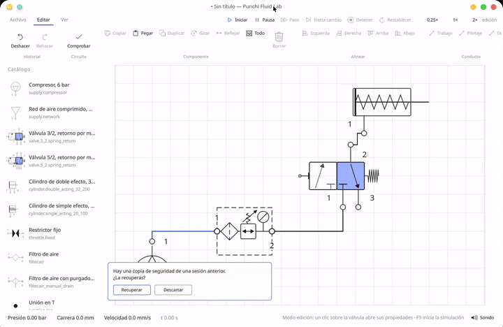

# Punchi Fluid Lab

**English** | [Español](README.es.md)

[](https://github.com/PunchiSoft/punchiFluidLab/actions/workflows/ci.yml)
[](LICENSE)
[](#)

> 🚧 **Under construction.** This is a working prototype, not a finished product. It is
> built by one person in the free days left by a full-time job, so it moves steadily but
> slowly, and **no delivery date is promised**: when a capability in
> [docs/capabilities.md](docs/capabilities.md) says `missing` or `partial`, that is exactly
> what it means. If something is not there, it says so; if it is half done, it says which
> half is missing.


*The window as it is today: ribbon, catalog, sheet and status bar, following the desktop's
own palette. The circuit is the sheet the program opens on: a compressor feeding the service
unit, the unit feeding a 3/2 valve in its rest position and the valve feeding a single-acting
cylinder. Every port carries its connection circle, and nothing is running, so the hoses keep
the neutral ink and the status bar reads `0,00 bar`. The interface is Spanish today —
[i18n/README.md](i18n/README.md) is the plan for the other languages.*



*The sheet in motion: the valve actuated and the cylinder moving, with the hoses coloured by
the pressure in them. 44 seconds at 4× playback. [Full video](assets/screenshots/run.mp4),
MP4, silent.*

A free, open simulator of pneumatic and hydraulic circuits, built so that a student with no
licence, no budget and no connection can draw a schematic, connect the ports, run the model
and watch the actuators move. The model, the format and the drawing are Rust; the window is
Qt Quick.

**Status: `0.1.0`, unreleased.** A working vertical slice: draw and edit a circuit, connect
port to port, keep several circuits in one project and switch between them, save and open
it, run the gas model, read the pressure on the hoses, and export the active sheet to PNG or
PDF.

No account, no key, no network. GPL-3.0-or-later: download it, teach with it, change it,
share it.

**Who it is for:** vocational and engineering students, teachers building exercises, and any
workshop that cannot justify a commercial licence. The tool that teaches the subject should
not be the thing a student cannot afford.

**What it is not:** a viewer, a course or a cloud service. No telemetry, no subscription, no
"education edition" with the useful features removed.

> **Continuing this project?** [docs/retomar.md](docs/retomar.md) (Spanish) is the
> continuity note: current state, what was built step by step, how to verify it, the
> decisions taken and the exact prompt to resume in a new session.

## Why this exists

In Latin America an industrial career is expensive before the first class. The software a
mechanical or electrical course expects you to learn on is priced for a company, and it is
usually tied to the brand of the machines in the laboratory. Student licences are rare,
teaching licences rarer, and a course that cannot afford them ends up teaching *around* the
tool instead of with it.

The consequence is well known and rarely said out loud: students look for a pirated copy
rather than tell the teacher they cannot pay. That copy arrives with its own bill — no
updates, malware on a personal laptop, credentials and documents exposed. Piracy is a
symptom, not a shortcut, and the honest fix is a tool that costs nothing to install and
nothing to run.

That is where this project comes from. It is written by someone who works in the industry
and also teaches, and it is built for the two places where the same knowledge is needed: the
classroom with no budget and the workshop that has to train its own people.

There the value is not decorative. An operator who has watched a chamber fill, a piston
travel and a flow choke at the critical ratio reads a slow cylinder as a diagnosis instead
of a mystery. A team that can install a simulator on every machine can work towards
autonomous maintenance — one of the pillars of total productive maintenance — without
buying a seat for it, which is the difference between a plan and a poster on the wall.

This is the motivation, not a measured result: the program is a prototype, and
[docs/capabilities.md](docs/capabilities.md) says what is still missing. But the direction is
the point. Free software is how a subject stops being an entrance fee.

## What exists today

| Crate | What it does now |
|---|---|
| `punchi-fluid-core` | Components, ports, connections and typed units (bar, litre, kelvin) |
| `punchi-fluid-catalog` | Component definitions read from TOML files: schema, validation, override rules |
| `punchi-fluid-file` | Versioned sheet format (v3), atomic write and the recent-document list |
| `punchi-fluid-solver` | Gas mass integration, cylinder with spring, damping and friction, ISO 6358 flow |
| `punchi-fluid-doc` | The edited document: placements, commands and bounded undo |
| `punchi-fluid-draw` | The one drawing of a circuit, in millimetres, behind a `Surface` trait |
| `punchi-fluid-export` | Standard sheets, title block, legend, and the PNG and PDF writers |
| `punchi-fluid-ffi` | The C ABI the window speaks: the document, the drawing frame, hit tests and export |
| `punchi-fluid-check` | Design checks: the faults a circuit can have before it is run |
| `punchi-fluid-cli` | `validate`, `simulate` and `check` without a window |
| `apps/punchi-fluid-qt` | The window: ribbon, catalog sidebar, sheet, status bar and the desktop's own palette, over the C ABI |

## Build and run

```bash
./scripts-dev/run.sh                                    # window; builds only if stale
./scripts-dev/run.sh --toggle                           # starts with the valve actuated
./scripts-dev/run.sh --no-build --theme dark            # already-built binary, dark palette
./scripts-dev/run.sh --theme light                      # pin the palette for a screenshot
cargo run --bin punchi-fluid-cli -- check circuit.pfluid   # headless check of a sheet
```

`run.sh` compiles only when a source changed and then executes the binary directly;
`--no-build` never invokes Cargo, and `--theme light|dark` is passed to the window. Without
`--theme`, the window follows the desktop. `--toggle` actuates the valve; it does not start
the simulation. `check` reads the sheet format the editor saves; `validate` and `simulate`
still read the legacy circuit format, as [the CLI reference](docs/reference/cli.md) explains.

In the window the transport runs the model: **Iniciar** (F9) starts, **Pausa** (F8) pauses,
**Paso** (F10) advances one frame, **Hasta cambio** stops at the first end stop or valve
change, **Detener** (F5) returns to editing and **Restablecer** (Ctrl+R) goes back to
`t = 0`. A spring-return valve is held while the pointer is down or **Espacio** is held, and
the speed selector sits beside the transport (a 20 mm cylinder with this valve finishes its
stroke in about 0.13 s of simulated time). The ribbon has three tabs — Archivo, Editar and
Ver — and the hint beside each command names its shortcut where one exists. The sidebar
lists the catalog with each component's own symbol; a click selects and a drag places it.

**Exportar** in Archivo opens a save dialog: a `.pdf` name writes a vector page, a `.png`
name a raster at 300 dpi. The **Hoja** group chooses one of nine named papers — A5 to A0,
Letter, Legal and Oficio — and the landscape orientation, and marks the one in use. The page
carries the frame, the title block and a legend of line classes and port numerals, and while
any symbol review is open it also carries the note that the symbols are not yet verified
against ISO 1219-1. The same circuit exported twice produces the same bytes. There is no
panel for margins, a custom size or the PNG resolution yet. The date is the day you export,
the drawing is scaled to fit and its scale is recorded in the title block, and
`Ctrl+Shift+E` opens the dialog.

**The paper is a decision, not a default.** A drawing is printed on the sheet the drawing
office uses, and that is not one size: ISO 216/5457 A5 to A0 for the ISO world;
US Letter and US Legal for the North American one; and **Oficio/Folio (216 × 330 mm)**, which
is neither of the two and is the paper most Chilean offices still stock. The plan is
[ADR 0012](docs/adr/0012-the-paper-a-drawing-is-printed-on.md); the custom size exists in
the export API but not in the window, and the last choice is not remembered per user yet.

Requirements: Rust stable (pinned in `rust-toolchain.toml`), Qt 6.5 or newer with Qt Quick,
CMake and Ninja. The Rust core builds with `cargo build --release -p punchi-fluid-ffi`; the
window with

```bash
cmake -S apps/punchi-fluid-qt -B apps/punchi-fluid-qt/build -G Ninja
cmake --build apps/punchi-fluid-qt/build
apps/punchi-fluid-qt/build/punchi-fluid
```

The core is linked as a static library, so the result is one binary with no runtime search
path. Keeping it in Rust is what also makes a WebAssembly build possible later.

## Components are files, not code

Every valve, cylinder or supply is a TOML definition in
[assets/catalog/](assets/catalog/). The application compiles those in, and loads
`~/.local/share/punchi-fluid-lab/catalog/` on top, where a file with the same `id`
replaces the built-in one:

```toml
id = "valve.3_2.spring_return"
category = "valve"

[behaviour]
type = "valve"
actuation = "toggle"
spring_return = true

[[behaviour.positions]]
name = "rest"
[[behaviour.positions.connection]]
from = "2"
to = "3"
conductance = 1.0e-9
```

A position lists the paths it opens, classified by the **role** of the ports
(`supply`, `working`, `exhaust`), so a 5/2 valve is a new file and not a new match
arm. The symbol is a list of primitives in the same file. A file with a mistake is
skipped, reported in the Catalog panel, and the rest keeps working. The full field
reference is in [assets/catalog/README.md](assets/catalog/README.md).

## The interface

Three regions and nothing else: a **ribbon** for what applies to the whole document,
a **sidebar that is the catalog** (grouped by category, with each component drawn by
its own symbol, drag to the sheet), and the **sheet** where the circuit lives and
reacts. Status bar at the bottom. Edit and simulation are visibly different modes, so
a stray click during a demonstration never destroys work.

The application takes its colours, accent and font size from the desktop: it reads
`kdeglobals` and follows the `org.freedesktop.appearance color-scheme` portal, so it
looks like the rest of Plasma and follows a live scheme change without restarting.
A semantic token layer is the only place a colour exists — a `Color32::` anywhere else
fails a test. Components use their own symbol, never a separate icon set.

**Honest status:** the regions, the tokens, the keyboard map and the help panel are
implemented. Breeze symbolic icons are not loaded yet (action buttons are text), the
desktop font *family* is read but not loaded (size is), and the UI strings are still
literals until the Fluent pass in M6.

The full specification — regions, keyboard map, contrast requirements, what the design
refuses — is in [docs/ui-ux.md](docs/ui-ux.md). The milestones with their acceptance
criteria are in [docs/plan.md](docs/plan.md).

## Symbols follow ISO 1219

A schematic that is *almost* conformant is worse than an obvious sketch: it gets read
as if it were correct. Diagram symbols follow **ISO 1219-1:2012**, in the conventions
of ISO 1219-2:2012 and ISO 1219-3:2016; port numerals follow the fluid-power
port-identification convention.

The national adoption applies too: **NCh-ISO 1219**, the Chilean adoption of ISO 1219, is the
text a reader in Chile is expected to follow, and a symbol is not called conformant here until
the adoption that applies to its reader is confirmed in its review. Which adoptions are
tracked, and what is still unverified, is the *National adoptions* table in
[docs/symbology.md](docs/symbology.md).

What that means in practice, and the review that enforces it, is in
[docs/symbology.md](docs/symbology.md): equal squares per valve position, flow arrows
in the direction of flow, blocking marks on closed ports, port numerals drawn from the
definition, spring and actuator at their ends, line classes for working, pilot and
drain lines, junction dots only where three lines meet.

**Honest status:** the structural half is enforced, not hoped for. A valve declares its
body and the renderer splits it into equal squares; the flow path and its arrow come
from the connection, the blocking mark from the position, the numerals from the port
table, and the spring and actuator from declared parts. Eight lint rules run when the
catalog loads, one test each.

The visual half is reviewed per symbol in
[assets/symbols/review/](assets/symbols/review/) at palette and canvas size. The 300 dpi
check needs the export pipeline, so every review says `status: pending-300dpi` and the
export keeps labelling the document as unverified until they do not. One symbol admits a
weaker shape in its own review: the fixed restrictor was drawn without the standard at
hand.

## Why Rust, and why these crates

The product is three different problems: the physics, the file format and the
schematic editor. Keeping them in separate crates means the solver can be tested
without a window, the format can migrate documents while the editor changes, and
the toolkit is a decision confined to one crate. Today the drawing crosses to the window
as a command buffer over a C ABI (`punchi-fluid-ffi`), and Qt Quick replays it with
`QPainter`.

The full reasoning, including what it costs, is in
[docs/adr/0005-qt-quick-over-a-c-abi.md](docs/adr/0005-qt-quick-over-a-c-abi.md).

## The physical model, in one paragraph

Pneumatics is not computational fluid dynamics. A circuit is a network of volumes
joined by restrictions: the ideal gas law for each volume, ISO 6358 for the flow
through a restriction (with the choked branch above the critical pressure ratio),
and a stiff integrator because pressure changes in milliseconds. Getting the model
right matters more than any UI decision.

## Validation

```bash
./scripts-dev/check.sh
```

Format, lints with `-D warnings`, all tests and a CLI smoke test over a temporary
circuit file. A green run proves the crates and the format; the window and the
physics still need eyes and a reference curve.

## Roadmap

Milestones, acceptance criteria and the evidence each one needs live in
[docs/plan.md](docs/plan.md); the coverage ledger and the delivery order are
[docs/capabilities.md](docs/capabilities.md) and [docs/next-steps.md](docs/next-steps.md).
In short:

- **v0.1** — workspace, domain, format, canvas, CLI, catalog of definition files. *Done.*
- **v0.2** — vertical slice: supply, 3/2 valve and single-acting cylinder with gas
  mass integration, piston dynamics and a clickable valve. *Done.*
- **M1** — shell: ribbon, sidebar, status bar, theme from the desktop, accessibility. *Done.*
- **M1.5** — symbol conformance against ISO 1219, with a lint and a review per symbol.
  *Structural half and visual review done; the 300 dpi review is open.*
- **M2** — one drawing, two exports: PDF and PNG from the same calls, standard paper,
  title block and legend. *Done.*
- **v0.3** — document model with undo, palette built from the catalog, place and
  connect components, orthogonal pipes, save and load. *Done.*
- **v0.4** — network solver driven by the circuit graph instead of one fixed layout;
  5/2 valves, flow controls, gauges. *Done.*
- **Next** — a project of circuits, the remaining instruments, the parts list, the
  electrical and digital libraries, and our own teaching material.
- **v1.0** — hydraulic model, AppImage and Flatpak, translation pipeline.

## Project documentation

The full index — every document, its kind, its status and the reading order — is
[docs/README.md](docs/README.md). The contract and the community files stay in the
repository root:

| Document | Purpose |
|---|---|
| [AGENTS.md](AGENTS.md) | canonical rules for people and agents |
| [CHANGELOG.md](CHANGELOG.md) | changes by date, under `Unreleased` |
| [CONTRIBUTING.md](CONTRIBUTING.md) | how to set up, test and send a change |
| [SECURITY.md](SECURITY.md) | how to report a vulnerability privately |
| [SUPPORT.md](SUPPORT.md) | where to ask, and what this project does not promise |
| [CODE_OF_CONDUCT.md](CODE_OF_CONDUCT.md) | the code of conduct, adopted by reference |
| [docs/README.md](docs/README.md) | the index: architecture, process, reference and decisions |

## Made with love, for the community

Free software is why a student in a workshop with no budget learns this subject on the same
kind of tool a company uses. The code is yours: read it, teach with it, fork it, and send
back what you fix. The project does not ask for an account, a key or a connection, and it
never will.

**Linux for everyone.**

## AI-assisted development

AI coding agents are a development aid here, not an author. They help implement,
investigate, refactor, document and test, and the maintainer remains responsible for the
technical decisions, the review, the validation and everything published.

Their instructions live with the project — [AGENTS.md](AGENTS.md) and
[`.agents/`](.agents/) — so an agent working on this repository follows the same rules as a
person: typed units, no `unwrap` or `panic!` outside tests, no `unsafe` outside the ABI,
symbols drawn by hand against ISO 1219-1, and **nothing taken from another program**. Those
rules were written and tuned by PunchiSoft for this architecture and this workflow, not
inherited from a template.

Because the program is meant to teach, an agent gets no licence to look finished: it may not
present as done what [docs/capabilities.md](docs/capabilities.md) still marks `missing` or
`partial`, and it may not invent a result to close a task. When something cannot be proven,
it says so — that is the same rule a person follows.

## License

GPL-3.0-or-later. See [LICENSE](LICENSE).

The licence applies to human-written and machine-generated copies alike: reading, quoting,
reimplementing or redistributing this project with an agent does not waive the notices, the
corresponding source or the attribution.
